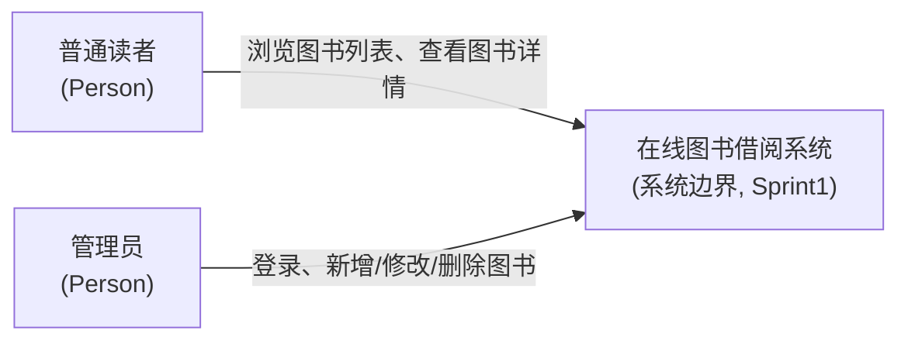
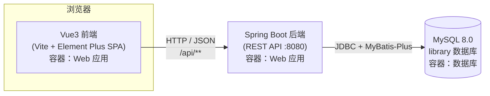
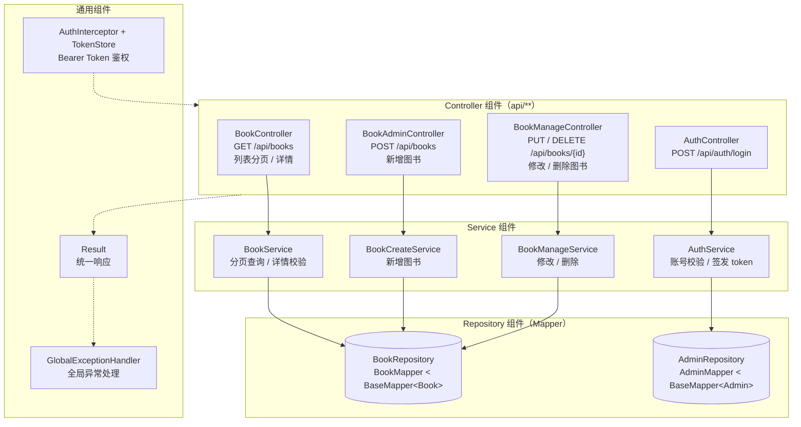

# 在线图书借阅系统 C4 架构图（Sprint1）

## 1. 系统上下文图（System Context Diagram）

> 参与者：普通读者、管理员、在线图书借阅系统。Sprint1 无外部第三方系统。

- **普通读者**：免登录浏览图书，使用 US-01 / US-02。
- **管理员**：登录后管理图书信息，使用 US-03（及修改、删除）。
- **外部依赖**：Sprint1 不依赖任何第三方系统，仅内部数据库。

---

## 2. 容器图（Container Diagram）

> 三个容器：Vue3 前端（浏览器）、Spring Boot 后端 API、MySQL 数据库。

- **Vue3 前端**：用户界面容器，Vite dev server 通过 `/api` 代理请求后端。
- **Spring Boot 后端**：业务与 API 容器，统一 `{code,message,data}` 响应。
- **MySQL 数据库**：持久化容器，`book`、`admin` 两张表。

---

## 3. 组件图（Component Diagram，后端内部）

> 核心链路：BookController → BookService → BookRepository；图中同时标注了登录认证与通用组件。

- **Controller 层**：承接 HTTP 请求，参数校验（`@Validated`）。
- **Service 层**：业务逻辑（分页、校验、新增/改/删、登录）。
- **Repository 层**：基于 MyBatis-Plus `BaseMapper` 的数据访问组件。
- **通用组件**：`AuthInterceptor` 拦截 `/api/**` 写操作校验 Bearer Token；`GlobalExceptionHandler` 统一输出友好错误。
